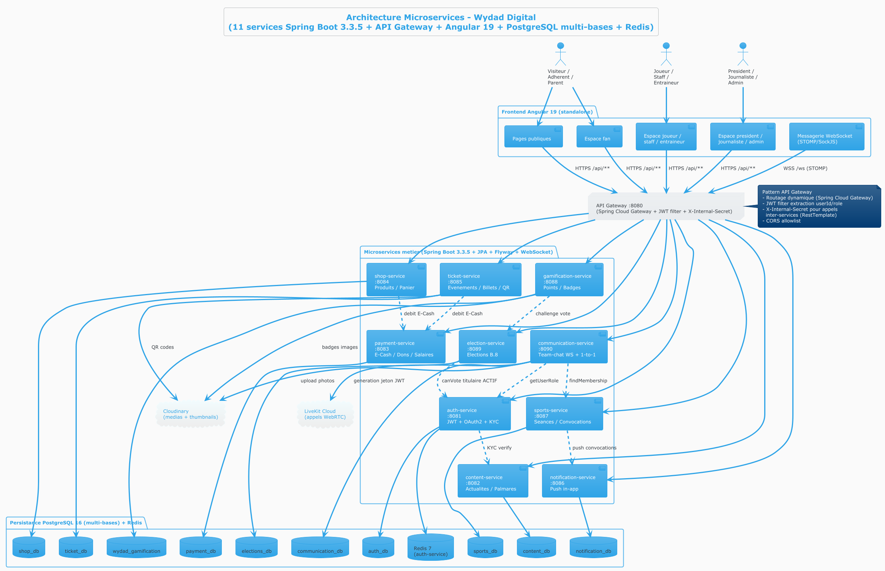
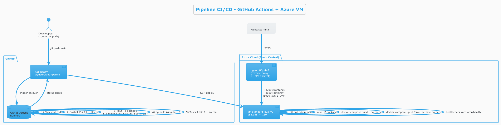
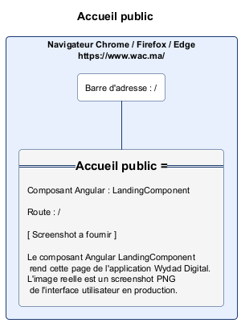
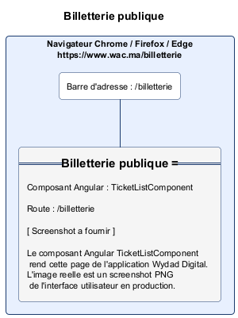
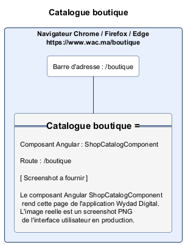
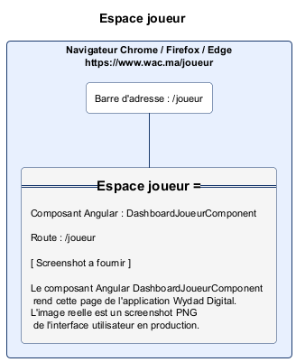
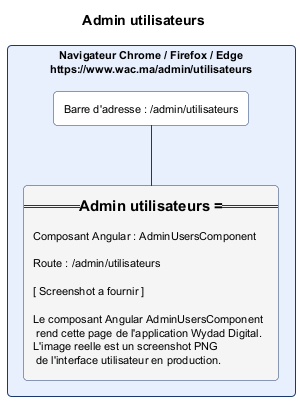
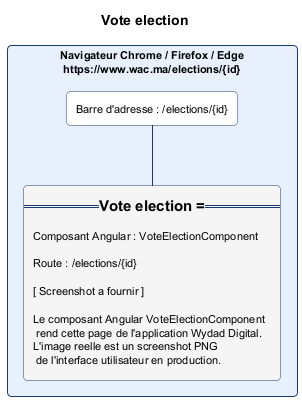

<p align="center">
  
</p>

<h1 align="center">Wydad Digital Platform</h1>

<p align="center">
  <em>Full-stack digital fan engagement platform for Wydad Athletic Club — built with microservices architecture</em>
</p>

<p align="center">
  
  
  
  
  
  
</p>

---

## Overview

**Wydad Digital** is a production-grade digital platform designed for the Wydad Athletic Club (WAC). It delivers a unified digital experience for supporters, club members, players, coaching staff, and administrators through **11 Spring Boot microservices**, an **Angular 19 SPA**, and a fully automated **CI/CD pipeline** deploying to **Azure**.

> **Tech highlights**: 467 Java source files · 62 unit/integration tests · 109 TypeScript components · 50 HTML templates · 12 Docker containers · GitHub Actions CI/CD with auto-deploy

---

## Key Features

| Module | What it does |
|--------|-------------|
| **Authentication & RBAC** | JWT-based auth with 8 user roles (Supporter, Player, Coach, Admin, President, Parent, Journalist, Staff), KYC document upload via Cloudinary, Redis session cache |
| **E-Commerce & Payments** | Product catalog, shopping cart, order management, invoice PDF generation, payment ledger |
| **Ticketing** | Match tickets, season subscriptions, VIP seats, QR code validation |
| **Sports Management** | Multi-discipline roster management, match convocations, match sheets, training sessions |
| **Gamification** | Loyalty points engine, achievement badges, fan leaderboards, challenges |
| **Elections** | Democratic club elections with real-time vote counting and result publication |
| **Real-Time Messaging** | WebSocket/STOMP group chats, team discussions, in-app notification system |
| **Content & Media** | News articles, match results, press accreditation workflow, media library |

---

## Architecture

The platform follows a **microservices architecture** with an API Gateway as single entry point:

<p align="center">
  
</p>

```
                         ┌──────────────┐
                         │   Angular    │
                         │   Frontend   │
                         └──────┬───────┘
                                │ :4200
                         ┌──────▼───────┐
                         │  API Gateway  │
                         │    :8080      │
                         └──────┬───────┘
            ┌───────┬───────┬───┴───┬───────┬───────┐
         :8081   :8082   :8083   :8084   :8085   :8086
         Auth   Content Payment  Shop   Ticket  Notif.
            └───────┴───────┴───┬───┴───────┴───────┘
         :8087   :8088   :8089  │  :8090
        Sports  Gamif.  Election│  Comms
            └───────┴───────┴───┘
                   │         │
            ┌──────▼──┐ ┌───▼────┐
            │PostgreSQL│ │ Redis  │
            │  :5432   │ │ :6379  │
            └──────────┘ └────────┘
```

> Full architecture documentation: [`docs/ARCHITECTURE.md`](docs/ARCHITECTURE.md)

---

## Tech Stack

### Backend
| Technology | Purpose |
|------------|---------|
| Java 21 LTS | Primary language |
| Spring Boot 3.3.5 | Microservice framework |
| Spring Cloud 2023.0.3 | API Gateway routing |
| Spring Security 6 | JWT authentication & authorization |
| Spring Data JPA / Hibernate | ORM & database access |
| PostgreSQL 16 | Relational database (one per service) |
| Redis 7 | Session cache & token blacklisting |
| Maven (multi-module) | Build system & dependency management |
| WebSocket + STOMP | Real-time bidirectional messaging |

### Frontend
| Technology | Purpose |
|------------|---------|
| Angular 19 | Single Page Application framework |
| TypeScript 5 | Type-safe frontend code |
| Tailwind CSS 3 | Utility-first responsive styling |
| Nginx Alpine | Production static file serving |

### DevOps & Infrastructure
| Technology | Purpose |
|------------|---------|
| Docker + Docker Compose | Container orchestration (12 services) |
| GitHub Actions | CI pipeline — build, test, Docker push, deploy |
| Azure VM (Standard B2s) | Production hosting |
| Docker Hub | Container image registry |

---

## Microservices Map

| Service | Port | DB | Source Files | Tests | Description |
|---------|------|----|:-----------:|:-----:|-------------|
| `api-gateway` | 8080 | — | 3 | 2 | Routes, JWT filter, CORS, rate limiting |
| `auth-service` | 8081 | `auth_db` | 89 | 10 | Users, roles, JWT, KYC, Cloudinary uploads |
| `content-service` | 8082 | `content_db` | 70 | 9 | News, matches, press, media content |
| `payment-service` | 8083 | `payment_db` | 28 | 2 | Payments, invoices, transaction ledger |
| `shop-service` | 8084 | `shop_db` | 54 | 4 | Products, carts, orders, promo codes |
| `ticket-service` | 8085 | `ticket_db` | 42 | 6 | Tickets, subscriptions, VIP, QR codes |
| `notification-service` | 8086 | `notification_db` | 23 | 4 | Push notifications, in-app alerts |
| `sports-service` | 8087 | `sports_db` | 68 | 12 | Rosters, convocations, match sheets |
| `gamification-service` | 8088 | `wydad_gamification` | 41 | 3 | Points, badges, leaderboards, challenges |
| `election-service` | 8089 | `elections_db` | 25 | 6 | Elections, ballots, vote counting |
| `communication-service` | 8090 | `communication_db` | 24 | 4 | Team chat (WebSocket/STOMP), messaging |
| `wydad-frontend` | 4200 | — | 109 TS | 50 HTML | Angular SPA with Tailwind CSS |

---

## Getting Started

### Prerequisites

- Java 21+, Maven 3.9+
- Node.js 20+, npm 10+
- Docker 24+, Docker Compose v2

### Quick Start

```bash
# 1. Clone
git clone https://github.com/Ilyas0236/projet-2026-devops.git
cd projet-2026-devops

# 2. Configure environment
cp .env.example .env
# Edit .env — generate required secrets:
#   openssl rand -base64 64   # for JWT_SECRET
#   openssl rand -base64 32   # for INTERNAL_SECRET

# 3. Build & launch all services
docker compose up -d --build

# 4. Verify health
docker compose ps
curl http://localhost:8080/actuator/health
```

### Access Points

| Service | URL |
|---------|-----|
| Frontend | http://localhost:4200 |
| API Gateway | http://localhost:8080 |
| pgAdmin | http://localhost:5050 |

---

## CI/CD Pipeline

Automated via **GitHub Actions** — see [`.github/workflows/ci.yml`](.github/workflows/ci.yml):

```
Push to main
  ├─► Build & Test (Maven + JUnit 5 for each service)
  ├─► Build Frontend (Angular production build)
  ├─► Docker Build & Push (12 images to Docker Hub)
  └─► Auto-Deploy to Azure VM via SSH (optional, requires secrets)
```

<p align="center">
  
</p>

---

## Project Structure

```
wydad-digital-parent/
├── .github/
│   ├── workflows/ci.yml          # CI/CD pipeline
│   ├── ISSUE_TEMPLATE/           # Bug report & feature request templates
│   └── pull_request_template.md  # PR template
├── api-gateway/                  # Spring Cloud Gateway
├── auth-service/                 # Authentication & authorization
├── communication-service/        # Real-time messaging (WebSocket)
├── content-service/              # News & media management
├── election-service/             # Club elections & voting
├── gamification-service/         # Loyalty & gamification engine
├── notification-service/         # Push notification system
├── payment-service/              # Payment processing
├── shop-service/                 # E-commerce module
├── sports-service/               # Sports & roster management
├── ticket-service/               # Ticketing & subscriptions
├── wydad-frontend/               # Angular 19 SPA
├── docs/
│   ├── architecture/             # Architecture diagrams (PlantUML)
│   ├── uml/                      # UML diagrams (class, sequence, UC, state)
│   ├── screenshots/              # UI wireframes & mockups
│   └── ARCHITECTURE.md           # Architecture overview
├── init-scripts/                 # PostgreSQL initialization
├── docker-compose.yml            # Full stack orchestration
├── pom.xml                       # Maven parent POM
├── .env.example                  # Environment template
├── CONTRIBUTING.md               # Contribution guidelines
└── SECURITY.md                   # Security policy
```

---

## Documentation

| Document | Description |
|----------|-------------|
| [`docs/ARCHITECTURE.md`](docs/ARCHITECTURE.md) | System architecture, design patterns, service responsibilities |
| [`docs/architecture/`](docs/architecture/) | PlantUML source & rendered architecture diagrams |
| [`docs/uml/`](docs/uml/) | UML diagrams: use cases, class, sequence, activity, state |
| [`docs/screenshots/`](docs/screenshots/) | UI wireframes for all major screens |
| [`.env.example`](.env.example) | Environment variables reference |

---

## Screenshots

<details>
<summary>Click to expand UI previews</summary>

| Screen | Preview |
|--------|---------|
| Home |  |
| Ticketing |  |
| Shop |  |
| Player Dashboard |  |
| Admin Panel |  |
| Elections |  |

</details>

---

## Author

**Ilyas** — EMSI (Ecole Marocaine des Sciences de l'Ingenieur)

Built as a **Projet de Fin d'Annee (PFA)** demonstrating full-stack development, microservices architecture, DevOps practices, and cloud deployment.

[](https://github.com/Ilyas0236)
